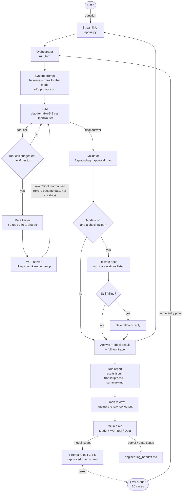

# Great.cards Card Advisor

This repo holds a chatbot that recommends Indian credit cards using the Great.cards MCP server (`https://bk-api.bankkaro.com/mcp`). Alongside it is an evaluation that tests the chatbot with 20 sceptical questions. The evaluation sorts each failure by cause (the model, an MCP tool, or the card data), fixes what can be fixed on the chatbot side, and writes up the server and data problems for engineering.

---

## 5-minute setup

**You need:** Python 3.12 or newer (developed and tested on 3.14), and an [OpenRouter](https://openrouter.ai) API key. The MCP server is public, so it needs no key.

**1. Clone the repo and install (about 2 minutes):**

```bash
git clone https://github.com/ayushk1233/great_cards.git && cd great_cards
```

```bash
python3 -m venv .venv && source .venv/bin/activate
```

```bash
pip install -r requirements.txt
```

**2. Add your key (about 30 seconds):**

```bash
cp .env.example .env
```

Open `.env` and set `OPENROUTER_API_KEY=...`. Never commit `.env`; it's already listed in `.gitignore`.

**3. Check that everything is connected (optional, about 20 seconds; makes 1 LLM call and about 3 MCP requests):**

```bash
python -m app.health
```

**4. Start the chat:**

```bash
streamlit run app/ui.py
```

Open http://localhost:8501 and try one of the example questions. Under each answer you'll see:
- the **guardrail check result**;
- a **Tool calls** panel showing the exact arguments and the raw server response, so every figure can be traced back to its source.

The sidebar switches between guardrail modes:

| Mode | What it does |
|---|---|
| `prompt` | Default, recommended. The fixed version that was measured |
| `off` | The baseline: no extra rules |
| `on` | Enforced: an answer that fails a check is rewritten once, then replaced with a safe reply |

**Offline tests** (no network, no API key):

```bash
pytest -q
```

Expected result: 116 passed, 12 xfailed. The xfailed tests are known weaknesses, pinned on purpose.

---

## Submission files

| Deliverable (assignment) | File |
|---|---|
| 1. Chatbot repository with a README | This repo. Chat UI: [app/ui.py](app/ui.py); agent loop: [app/agent/orchestrator.py](app/agent/orchestrator.py) |
| Task 2: the 20 sceptical questions | [evals/CASES.md](evals/CASES.md) (with reasoning) · [evals/questions.json](evals/questions.json) (machine-readable) |
| 2. `failures.md`: every failure, classified Model / MCP tool / Data | [reports/failures.md](reports/failures.md) |
| Task 4: model-side fix with before/after | [reports/fixes_before_after.md](reports/fixes_before_after.md) (all fixes and results) · [reports/task4_model_fix.md](reports/task4_model_fix.md) (fix-by-fix detail) |
| Task 4: engineering spec for the top MCP/data issue | [reports/engineering_handoff.md](reports/engineering_handoff.md): Part A is the eligibility spec; Part B covers 13 other server and data problems |
| Task 5: guardrails, plus proposed extra guardrails | [reports/guardrails.md](reports/guardrails.md) |
| 3. One-page note to the product owner | [reports/note_to_product_owner.md](reports/note_to_product_owner.md) |
| Unedited chatbot transcripts, before | [reports/20261010T230941Z_off/transcripts.md](reports/20261010T230941Z_off/transcripts.md) · [review](reports/20261010T230941Z_off/review.md) |
| Unedited chatbot transcripts, after | [reports/20261011T005033Z_prompt/transcripts.md](reports/20261011T005033Z_prompt/transcripts.md) · [review](reports/20261011T005033Z_prompt/review.md) |
| 4. AI chat transcripts (how I worked with AI) | *Links to be added* |

**Supporting evidence:**
- [discovery/FINDINGS.md](discovery/FINDINGS.md): what the MCP server actually does, verified by hand before the chatbot was built.
- [discovery/raw/](discovery/raw/): every recorded server response cited in the reports.
- [discovery/tools.json](discovery/tools.json): the server's tool catalogue.

---

## What's in the repo

```
app/
  ui.py                 Streamlit chat (presentation only)
  config.py             settings from .env
  health.py             backend connectivity check
  agent/
    orchestrator.py     one chat turn: LLM ⇄ MCP tool loop, then validation
    prompts.py          baseline prompt and the guardrail rule blocks (per mode)
    validation.py       the ₹ / approval / tax checks (pure functions)
    llm.py              OpenRouter client (the only module importing it)
  mcp/
    client.py           MCP session; normalises every result and error into one shape
    tools.py            allowlisted tools, with schemas taken verbatim from the live server
    ratelimit.py        shared, file-backed rate limiter (the server limits at about 65 requests / 3 min)
  evaluation/
    runner.py           resumable, rate-limited 20-case runner
    checks.py, report.py, store.py, cases.py
evals/                  the 20 cases (source of truth)
reports/                every run (unedited) and every write-up
discovery/              server exploration: findings, raw responses, tool catalogue
tests/                  offline tests: fake LLM, fake MCP, recorded server data
```

**Reproducing the evaluation.** Each full run makes about 205 MCP requests, takes about 12 minutes because requests are paced, and costs $0.25–0.50 in OpenRouter usage.

Plan the run without any network calls or cost:

```bash
python -m app.evaluation.runner --dry-run
```

Before (baseline):

```bash
python -m app.evaluation.runner --mode off
```

After (fixed):

```bash
python -m app.evaluation.runner --mode prompt
```

**Design choices worth knowing:**
- **Never modifies the server:** the MCP server is only read, never changed.
- **Paced requests:** every HTTP request goes through one rate limiter that the UI and the runner share.
- **Limits per turn:** at most 6 tool calls, and a 180-second deadline.
- **No answers from memory:** card facts come only from tool calls.
- **The server's playbook is treated as data:** its 42k-character advisor playbook is passed to the model as a tool result, not as instructions, because it asks for figures no tool returns.

---

## Pipeline flow


